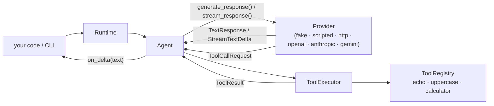

# NexusAgent

[](https://github.com/Abolfazlrwm/nexusagent/actions/workflows/ci.yml)
[](https://github.com/Abolfazlrwm/nexusagent/actions/workflows/ci.yml)
[](https://pypi.org/project/nexusagent-runtime/)
[](https://pypi.org/project/nexusagent-runtime/)
[](LICENSE)

**A modular runtime for AI agents in Python — zero runtime dependencies, a small readable core, and an honest feature list.**

Most agent frameworks hand you a galaxy of abstractions. NexusAgent is the opposite: ~800 statements of typed, contract-tested core that you can read in one sitting — providers, tools, a bounded autonomous tool loop, an async mirror of the whole stack, and a CLI. Nothing hidden, nothing magic.

```python
from nexusagent import create_application_runtime

runtime = create_application_runtime()  # offline `fake` provider by default

result = runtime.run("Hello NexusAgent")
print(result.output)  # fake response: Hello NexusAgent
print(result.success)  # True

print(runtime.execute_tool("calculator", "2 + 3"))  # 5
```

## Why NexusAgent

- **Zero runtime dependencies** — the whole core is the Python standard library. `pip install nexusagent-runtime` pulls nothing else.
- **Readable by design** — the core is small enough to audit in an afternoon; architecture rules are enforced by tests, not comments.
- **Honest** — the feature list below says what exists *and what doesn't*. No fake benchmarks, no aspirational docs.
- **Typed** — ships `py.typed`; the source itself passes `mypy --strict`.
- **Tested** — 1090+ contract tests, ≥95% coverage floor enforced in CI.

## Features

| Capability | Status |
| --- | --- |
| Provider abstraction (bring any backend) | ✅ |
| Autonomous tool loop, bounded by `max_iterations` | ✅ |
| OpenAI-compatible adapter (OpenAI, Ollama, LM Studio, vLLM, …) | ✅ [ADR 0005](docs/adr/0005-openai-compatible-provider.md) |
| Anthropic-compatible adapter (Anthropic, gateways, …) | ✅ [ADR 0007](docs/adr/0007-anthropic-compatible-provider.md) |
| Gemini adapter (Google Gemini, gateways, …) | ✅ [ADR 0008](docs/adr/0008-gemini-provider.md) |
| Vendor-neutral HTTP wire protocol | ✅ [docs/protocol.md](docs/protocol.md) |
| Built-in tools: `echo`, `uppercase`, `calculator` | ✅ |
| Custom tools / custom providers via small ABCs | ✅ [guides](docs/) |
| Configuration via `NEXUS_*` environment variables | ✅ |
| CLI (`nexusagent`, `python -m nexusagent`) | ✅ |
| Fully typed (`py.typed`), strict mypy clean | ✅ |
| Async execution (additive layer, same contracts) | ✅ [ADR 0006](docs/adr/0006-async-execution-model.md) |
| Streaming responses (SSE, all HTTP adapters, sync + async) | ✅ [ADR 0009](docs/adr/0009-streaming-responses.md) |
| Memory, planning, multi-agent orchestration | ❌ |
| Retries / backoff on HTTP failures | ❌ |

## Architecture



The Provider answers with text or requests a tool; the Agent runs the tool
and feeds the result back, repeating until a text answer or the iteration
limit. Deeper details: [docs/architecture.md](docs/architecture.md) ·
concepts: [docs/concepts.md](docs/concepts.md) · decisions:
[docs/adr/](docs/adr/).

## Installation

```bash
pip install nexusagent-runtime
```

> The **import name** is `nexusagent`; the **PyPI distribution** is
> `nexusagent-runtime` — the exact name `nexusagent` is blocked on PyPI by an
> unrelated placeholder package (`nexus-agent`), see
> [ADR 0004](docs/adr/0004-pypi-distribution-name.md).

Requires Python 3.10–3.13. From source:

```bash
git clone https://github.com/Abolfazlrwm/nexusagent
cd nexusagent
pip install -e ".[dev]"
python scripts/check.py   # lint + format + mypy --strict + tests
```

## Usage

### Agent with tools

```python
from nexusagent import create_application_runtime

runtime = create_application_runtime()

print(runtime.list_tools())
# [EchoTool, UppercaseTool, CalculatorTool]

# The provider decides when to request a tool; the agent runs the loop.
result = runtime.run("What is 19 + 23?")
```

### The tool loop, end to end, offline

```bash
python examples/tool_loop_demo.py
```

Starts a local "model backend" speaking the [HTTP protocol](docs/protocol.md),
requests the calculator, and turns the result into a final answer — no API
key, no internet.

### OpenAI-compatible providers

The `openai` provider speaks the Chat Completions wire format — OpenAI
itself, plus every compatible server (Ollama, LM Studio, vLLM, OpenRouter,
Groq, ...). Tool calling works end to end: tools are advertised as functions
with a single `input` string parameter, and results (including errors) are
fed back to the model. Zero dependencies — no vendor SDK.

```bash
export NEXUS_PROVIDER=openai
export NEXUS_MODEL=gpt-4o-mini
export NEXUS_API_KEY=sk-...       # optional for local servers
nexusagent "What is 19 + 23?"
```

To run against a local server instead, set
`NEXUS_ENDPOINT=http://localhost:11434/v1/chat/completions` (Ollama) and drop
the API key. Design details: [ADR 0005](docs/adr/0005-openai-compatible-provider.md).

### Anthropic-compatible providers

The `anthropic` provider speaks the Anthropic Messages wire format — Anthropic
itself, plus compatible gateways. Tool calling works end to end: tools are
advertised with a JSON Schema of a single `input` string parameter, and results
(including errors, via the native `is_error` flag) are fed back to the model.
Zero dependencies — no vendor SDK.

```bash
export NEXUS_PROVIDER=anthropic
export NEXUS_MODEL=claude-sonnet-4-5
export NEXUS_API_KEY=sk-ant-...    # required by the official API
nexusagent "What is 19 + 23?"
```

To run against a compatible gateway instead, set
`NEXUS_ENDPOINT=https://your-gateway.example/v1/messages`. The wire format
requires `max_tokens` on every request; NexusAgent sends 1024 by default.
Design details: [ADR 0007](docs/adr/0007-anthropic-compatible-provider.md).

### Gemini provider

The `gemini` provider speaks Google's Gemini `generateContent` wire format —
Gemini itself, plus compatible gateways. Tool calling works end to end: tools
are declared with a single `input` string parameter (Gemini's uppercase Schema
enums), and results (including errors, fed back inside the `functionResponse`
object) are given back to the model. Zero dependencies — no vendor SDK.

```bash
export NEXUS_PROVIDER=gemini
export NEXUS_MODEL=gemini-2.5-flash
export NEXUS_API_KEY=...           # required by the official API
nexusagent "What is 19 + 23?"
```

To run against a compatible gateway instead, set `NEXUS_ENDPOINT` to the
server's **base URL** — the adapter appends
`/v1beta/models/{model}:generateContent`. Unlike the Anthropic wire format,
`max_tokens` is optional here; when set explicitly it is sent as
`generationConfig.maxOutputTokens`. Design details:
[ADR 0008](docs/adr/0008-gemini-provider.md).

### Streaming responses

Every HTTP adapter can stream text as it is generated — Server-Sent Events,
parsed with the standard library, still zero runtime dependencies. Pass an
`on_delta` callback and it fires with every text fragment as it arrives;
the returned result still carries the complete answer. Without the callback
nothing changes.

```python
from nexusagent import create_application_runtime

runtime = create_application_runtime()
result = runtime.run("What is 19 + 23?", on_delta=lambda text: print(text, end="", flush=True))
print()  # deltas are already printed; result.output is the full answer
```

The same works on the async runtime (`await runtime.run(..., on_delta=...)`),
and `nexusagent --stream "prompt"` streams straight in the terminal. Tool
calling is fully supported while streaming: fragments that arrive before a
tool request are forwarded too, and the loop feeds results back as always.
Design details: [ADR 0009](docs/adr/0009-streaming-responses.md).

### Async runtime

The async layer mirrors the sync contracts one-to-one — `await runtime.run(...)`,
`await runtime.execute_tool(...)`, and awaited `AsyncTool` tools. Sync providers
(including `openai`) keep working under the event loop through a thread bridge,
with zero runtime dependencies.

```python
import asyncio

from nexusagent import create_async_runtime


async def main() -> None:
    runtime = create_async_runtime()  # offline `fake` provider by default
    result = await runtime.run("Hello NexusAgent")
    print(result.output)  # fake response: Hello NexusAgent


asyncio.run(main())
```

Details, async tools and concurrency: [guide](docs/guides/async.md) ·
design: [ADR 0006](docs/adr/0006-async-execution-model.md).

### CLI

```bash
nexusagent "your prompt"          # or: python -m nexusagent "your prompt"
nexusagent --stream "your prompt" # print provider text as it is generated
nexusagent tool list
nexusagent tool run calculator "2 + 3"
```

### Configuration

| Variable | Meaning | Default |
| --- | --- | --- |
| `NEXUS_PROVIDER` | `fake`, `http`, `openai`, `anthropic` or `gemini` | `fake` |
| `NEXUS_ENDPOINT` | HTTP/OpenAI/Anthropic provider URL; API base for `gemini` (model appended) | — |
| `NEXUS_MODEL` | model identifier passed to the provider (required for `openai`/`anthropic`/`gemini`) | — |
| `NEXUS_API_KEY` | sent as `Bearer` (OpenAI), `x-api-key` (Anthropic) or `x-goog-api-key` (Gemini); never logged, masked in reprs | — |
| `NEXUS_TIMEOUT` | HTTP timeout in seconds | `30` |

## Examples

All examples run offline, with no API keys:

- [`examples/basic.py`](examples/basic.py) — smallest possible run
- [`examples/custom_tool.py`](examples/custom_tool.py) — define and register your own tool
- [`examples/tool_loop_demo.py`](examples/tool_loop_demo.py) — the autonomous tool loop over local HTTP
- [`examples/streaming.py`](examples/streaming.py) — streamed text through `on_delta`, offline
- [`examples/async_tool_loop.py`](examples/async_tool_loop.py) — the async tool loop with an awaited tool
- [`examples/http_provider_local.py`](examples/http_provider_local.py) — `http` provider against a local backend

## Documentation

- [Architecture](docs/architecture.md) — layers, module map, dependency rules
- [Concepts](docs/concepts.md) — Agent, Provider, Tool, Runtime, Settings
- [Guides](docs/) — write a custom [provider](docs/guides/custom-provider.md), [tool](docs/guides/custom-tool.md) or [async runtime](docs/guides/async.md)
- [HTTP protocol](docs/protocol.md) — wire format for backends
- [ADRs](docs/adr/) — architecture decision records (0001–0009)
- [Security policy](SECURITY.md) · [Changelog](CHANGELOG.md) · [Contributing](CONTRIBUTING.md)

## Project status

Actively developed, pre-1.0. See [PROJECT_STATUS.md](PROJECT_STATUS.md) for
a candid snapshot of what works and what the next steps are. Breaking public
API changes require an ADR and are discussed in the open.

## License

[MIT](LICENSE)
