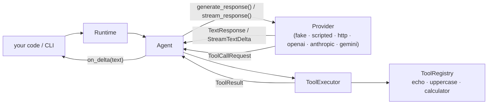

# NexusAgent

[](https://github.com/Abolfazlrwm/nexusagent/actions/workflows/ci.yml)
[](https://github.com/Abolfazlrwm/nexusagent/actions/workflows/ci.yml)
[](https://pypi.org/project/nexusagent-runtime/)
[](https://pypi.org/project/nexusagent-runtime/)
[](https://abolfazlrwm.github.io/nexusagent/)
[](LICENSE)

**A modular runtime for AI agents in Python — zero runtime dependencies, a small readable core, and an honest feature list.**

Most agent frameworks hand you a galaxy of abstractions. NexusAgent is the opposite: ~1,700 statements of typed, contract-tested core that you can read in one sitting — providers, tools, a bounded autonomous tool loop, an async mirror of the whole stack, and a CLI. Nothing hidden, nothing magic.

> **▶ Try it live, right now:** open the [in-browser demo](https://abolfazlrwm.github.io/nexusagent/) —
> it loads the real wheel from PyPI (via Pyodide) and runs the actual agent loop, tool loop and
> conversation memory on the page. No install, no API keys, nothing to configure.

```python
from nexusagent import create_application_runtime

runtime = create_application_runtime()  # offline `fake` provider by default

result = runtime.run("Hello NexusAgent")
print(result.output)  # fake response: Hello NexusAgent
print(result.success)  # True

print(runtime.execute_tool("calculator", "2 + 3"))  # 5
```

## Why NexusAgent

- **Zero runtime dependencies** — the whole core is the Python standard library. `pip install nexusagent-runtime` pulls nothing else.
- **Automatic retries** — transient HTTP failures (connection errors, timeouts, 429/5xx) are retried with exponential backoff, full jitter and `Retry-After` support. See [ADR 0011](docs/adr/0011-http-retry-backoff.md).
- **Conversation memory** — opt-in memory composes remembered turns into each run's prompt, so the agent carries context across runs with any provider — in-process (`InMemoryMemory`) or persisted to a local SQLite file (`SQLiteMemory`). See [ADR 0012](docs/adr/0012-conversation-memory.md) and [ADR 0013](docs/adr/0013-sqlite-memory.md).
- **Stable public API** — 1.0 declares SemVer stability over the full root surface; a CI-pinned test fails on any accidental removal, rename or silent addition. See [ADR 0010](docs/adr/0010-1.0-api-stability-and-versioning-policy.md).
- **Readable by design** — the core is small enough to audit in an afternoon; architecture rules are enforced by tests, not comments.
- **Honest** — the feature list below says what exists *and what doesn't*. No fake benchmarks, no aspirational docs.
- **Typed** — ships `py.typed`; the source itself passes `mypy --strict`.
- **Tested** — 1300+ contract tests, ≥95% coverage floor enforced in CI.

## Features

| Capability | Status |
| --- | --- |
| Provider abstraction (bring any backend) | ✅ |
| Autonomous tool loop, bounded by `max_iterations` | ✅ |
| OpenAI-compatible adapter (OpenAI, Ollama, LM Studio, vLLM, …) | ✅ [ADR 0005](docs/adr/0005-openai-compatible-provider.md) |
| Anthropic-compatible adapter (Anthropic, gateways, …) | ✅ [ADR 0007](docs/adr/0007-anthropic-compatible-provider.md) |
| Gemini adapter (Google Gemini, gateways, …) | ✅ [ADR 0008](docs/adr/0008-gemini-provider.md) |
| Vendor-neutral HTTP wire protocol | ✅ [docs/protocol.md](docs/protocol.md) |
| Built-in tools: `echo`, `uppercase`, `calculator` | ✅ |
| Custom tools / custom providers via small ABCs | ✅ [guides](docs/) |
| Configuration via `NEXUS_*` environment variables | ✅ |
| CLI (`nexusagent`, `python -m nexusagent`) | ✅ |
| Fully typed (`py.typed`), strict mypy clean | ✅ |
| Stable public API under SemVer (full root surface, pinned by CI) | ✅ [ADR 0010](docs/adr/0010-1.0-api-stability-and-versioning-policy.md) |
| Async execution (additive layer, same contracts) | ✅ [ADR 0006](docs/adr/0006-async-execution-model.md) |
| Streaming responses (SSE, all HTTP adapters, sync + async) | ✅ [ADR 0009](docs/adr/0009-streaming-responses.md) |
| Retries / backoff on HTTP failures (429/5xx, jitter, `Retry-After`) | ✅ [ADR 0011](docs/adr/0011-http-retry-backoff.md) |
| Conversation memory (opt-in, in-process, provider-agnostic) | ✅ [ADR 0012](docs/adr/0012-conversation-memory.md) |
| Persistent conversation memory (local SQLite file, same contract) | ✅ [ADR 0013](docs/adr/0013-sqlite-memory.md) |
| Native per-vendor history threading (real `messages`/`contents` roles) | ✅ [ADR 0014](docs/adr/0014-native-history-threading.md) |
| Multi-agent orchestration (explicit router-over-agents team) | ✅ [ADR 0015](docs/adr/0015-multi-agent-orchestration.md) |
| Offline demo brain — run the full loop with zero API keys | ✅ [ADR 0016](docs/adr/0016-offline-demo-provider.md) |
| Planning (plan-then-execute), multi-hop handoff chains, graph engines | ❌ |

## Architecture



The Provider answers with text or requests a tool; the Agent runs the tool
and feeds the result back, repeating until a text answer or the iteration
limit. Deeper details: [docs/architecture.md](docs/architecture.md) ·
concepts: [docs/concepts.md](docs/concepts.md) · decisions:
[docs/adr/](docs/adr/).

## Installation

```bash
pip install nexusagent-runtime
```

> The **import name** is `nexusagent`; the **PyPI distribution** is
> `nexusagent-runtime` — the exact name `nexusagent` is blocked on PyPI by an
> unrelated placeholder package (`nexus-agent`), see
> [ADR 0004](docs/adr/0004-pypi-distribution-name.md).

Requires Python 3.10–3.13. From source:

```bash
git clone https://github.com/Abolfazlrwm/nexusagent
cd nexusagent
pip install -e ".[dev]"
python scripts/check.py   # lint + format + mypy --strict + tests
```

## Usage

### Everything public imports from the root

Since 1.0 the complete public API — the agent layers, factories, the
`Provider` contract, the tool layer, the typed errors and the offline
testing providers — imports from the package root and is covered by the
stability contract (see [ADR 0010](docs/adr/0010-1.0-api-stability-and-versioning-policy.md)):

```python
from nexusagent import (
    Agent,
    Provider,
    Tool,
    ToolRegistry,
    create_application_runtime,
    create_provider,
)
```

Vendor wire adapters and the built-in demo tools are constructed through
`create_provider()` / `Settings` and the registry; they are deliberately
not part of the root surface. Submodule imports keep working, but only
the root is guaranteed stable.

### Agent with tools

```python
from nexusagent import create_application_runtime

runtime = create_application_runtime()

print(runtime.list_tools())
# [EchoTool, UppercaseTool, CalculatorTool]

# The provider decides when to request a tool; the agent runs the loop.
result = runtime.run("What is 19 + 23?")
```

### The tool loop, end to end, offline

```bash
python examples/tool_loop_demo.py
```

Starts a local "model backend" speaking the [HTTP protocol](docs/protocol.md),
requests the calculator, and turns the result into a final answer — no API
key, no internet.

### OpenAI-compatible providers

The `openai` provider speaks the Chat Completions wire format — OpenAI
itself, plus every compatible server (Ollama, LM Studio, vLLM, OpenRouter,
Groq, ...). Tool calling works end to end: tools are advertised as functions
with a single `input` string parameter, and results (including errors) are
fed back to the model. Zero dependencies — no vendor SDK.

```bash
export NEXUS_PROVIDER=openai
export NEXUS_MODEL=gpt-4o-mini
export NEXUS_API_KEY=sk-...       # optional for local servers
nexusagent "What is 19 + 23?"
```

To run against a local server instead, set
`NEXUS_ENDPOINT=http://localhost:11434/v1/chat/completions` (Ollama) and drop
the API key. Design details: [ADR 0005](docs/adr/0005-openai-compatible-provider.md).

### Anthropic-compatible providers

The `anthropic` provider speaks the Anthropic Messages wire format — Anthropic
itself, plus compatible gateways. Tool calling works end to end: tools are
advertised with a JSON Schema of a single `input` string parameter, and results
(including errors, via the native `is_error` flag) are fed back to the model.
Zero dependencies — no vendor SDK.

```bash
export NEXUS_PROVIDER=anthropic
export NEXUS_MODEL=claude-sonnet-4-5
export NEXUS_API_KEY=sk-ant-...    # required by the official API
nexusagent "What is 19 + 23?"
```

To run against a compatible gateway instead, set
`NEXUS_ENDPOINT=https://your-gateway.example/v1/messages`. The wire format
requires `max_tokens` on every request; NexusAgent sends 1024 by default.
Design details: [ADR 0007](docs/adr/0007-anthropic-compatible-provider.md).

### Gemini provider

The `gemini` provider speaks Google's Gemini `generateContent` wire format —
Gemini itself, plus compatible gateways. Tool calling works end to end: tools
are declared with a single `input` string parameter (Gemini's uppercase Schema
enums), and results (including errors, fed back inside the `functionResponse`
object) are given back to the model. Zero dependencies — no vendor SDK.

```bash
export NEXUS_PROVIDER=gemini
export NEXUS_MODEL=gemini-2.5-flash
export NEXUS_API_KEY=...           # required by the official API
nexusagent "What is 19 + 23?"
```

To run against a compatible gateway instead, set `NEXUS_ENDPOINT` to the
server's **base URL** — the adapter appends
`/v1beta/models/{model}:generateContent`. Unlike the Anthropic wire format,
`max_tokens` is optional here; when set explicitly it is sent as
`generationConfig.maxOutputTokens`. Design details:
[ADR 0008](docs/adr/0008-gemini-provider.md).

### Streaming responses

Every HTTP adapter can stream text as it is generated — Server-Sent Events,
parsed with the standard library, still zero runtime dependencies. Pass an
`on_delta` callback and it fires with every text fragment as it arrives;
the returned result still carries the complete answer. Without the callback
nothing changes.

```python
from nexusagent import create_application_runtime

runtime = create_application_runtime()
result = runtime.run("What is 19 + 23?", on_delta=lambda text: print(text, end="", flush=True))
print()  # deltas are already printed; result.output is the full answer
```

The same works on the async runtime (`await runtime.run(..., on_delta=...)`),
and `nexusagent --stream "prompt"` streams straight in the terminal. Tool
calling is fully supported while streaming: fragments that arrive before a
tool request are forwarded too, and the loop feeds results back as always.
Design details: [ADR 0009](docs/adr/0009-streaming-responses.md).

### Automatic retries

Transient HTTP failures — connection errors, timeouts, and `429`/`5xx`
statuses — are retried automatically on every HTTP provider, on both the
request and the streaming paths. Backoff starts at 0.5s, doubles per
attempt and caps at 8s, with full jitter so concurrent clients do not
retry in lockstep; an integer `Retry-After` hint from the server wins
when present (bounded by the same cap). Permanent failures —
authentication, bad requests, other `4xx` — fail fast as always, and a
mid-stream failure is never retried, so streamed fragments never repeat.

```bash
export NEXUS_RETRIES=5   # default 2; 0 disables and fails on first error
```

Design details: [ADR 0011](docs/adr/0011-http-retry-backoff.md).

### Conversation memory

By default every run is independent. Give the runtime an in-process memory
and each successful run records its user input and final answer, then the
next run's prompt carries that transcript — the model remembers names,
decisions and earlier results across runs. The provider contract is
touched nowhere, so memory works with every provider, including your own
subclasses; a bounded FIFO keeps long sessions flat (`max_turns`, default
100, oldest evicted first).

```python
from nexusagent import InMemoryMemory, create_runtime

memory = InMemoryMemory()  # bounded FIFO, default max_turns=100
runtime = create_runtime(memory=memory)

runtime.run("My name is Sara")
result = runtime.run("What is my name?")
print(result.output)  # the model now knows

print(len(memory))  # 4 turns: two completed exchanges
memory.clear()  # start fresh
```

Failed runs record nothing, and a memory with no history composes the
prompt byte-for-byte like the no-memory path. Design details:
[ADR 0012](docs/adr/0012-conversation-memory.md).

#### Persistent memory (SQLite)

`InMemoryMemory` lives in the process and is gone when it ends. To keep
history across restarts, hand the runtime a `SQLiteMemory`: turns live in
a local SQLite database file (`sqlite3` is in the standard library, so
still zero dependencies), the bounded-FIFO semantics and `max_turns` cap
match the in-process backend, and the oldest rows are evicted the same
way — the eviction itself is persisted.

```python
from nexusagent import SQLiteMemory, create_runtime

memory = SQLiteMemory("session.db", max_turns=50)  # created on first use
runtime = create_runtime(memory=memory)

runtime.run("My name is Sara")
memory.close()

# A later process reopens the same file and remembers:
memory = SQLiteMemory("session.db", max_turns=50)
runtime = create_runtime(memory=memory)
print(runtime.run("What is my name?").output)  # the model still knows
memory.close()
```

Every mutation commits immediately; `close()` (or using the instance as a
context manager) releases the database connection, and runtimes that open
the same file one after another see the same turns. Design details:
[ADR 0013](docs/adr/0013-sqlite-memory.md).

#### Native history threading

By default (and for every custom provider) the remembered transcript is
composed into the prompt text. The three vendor-native adapters opt into
something better (ADR 0014): with memory configured they rehydrate the
remembered turns into their wire format's real multi-message
conversation — OpenAI and Anthropic send proper `user`/`assistant`
`messages` entries, Gemini sends `contents` with `model` role — so the
model sees the conversation exactly the way its API is designed to
receive it, not a flattened transcript. Providers that have not opted in
keep the composed prompt byte-for-byte.

```python
from nexusagent import Agent, InMemoryMemory
from nexusagent.openai_provider import OpenAIProvider
from nexusagent.provider import ProviderConfig

provider = OpenAIProvider(ProviderConfig(model="gpt-4o-mini", api_key="sk-..."))
agent = Agent(provider, memory=InMemoryMemory())

agent.run("My name is Sara")
agent.run("What is my name?")
# the second request's body carries:
# messages: [{user: "My name is Sara"},
#            {assistant: "..."},
#            {user: "What is my name?"}]
```

Watch it offline: [`examples/native_history.py`](examples/native_history.py)
points the real adapter at a local echo backend and prints the exact
request body. Design details: [ADR 0014](docs/adr/0014-native-history-threading.md).

### Multi-agent orchestration

One prompt, one specialist, one answer: `AgentTeam` maps names to
`Agent` instances and asks a router — a plain callable you can read —
which member handles each prompt. The selected member's bounded tool
loop, its tools, its memory and its streaming all run unchanged, and
`TeamResult.agent_name` records who answered. A routing failure is a
failed result with the reason in `output`, never a crash mid-loop.
`create_provider_router` builds the LLM-decides variant from any
`Provider`: one `generate()` call listing the names, then a documented,
deterministic parse — no graphs, no handoff chains, no shared state
(ADR 0015).

```python
from nexusagent import Agent, AgentTeam, ScriptedProvider, TextResponse, create_provider_router

router = create_provider_router(scripted_router_provider, ["greeter", "math"])

team = AgentTeam(
    {
        "greeter": Agent(ScriptedProvider([TextResponse("Nice to meet you, Sara!")])),
        "math": math_agent_with_calculator_tool,
    },
    router,
)

result = team.run("what is 19 + 23?")
print(result.agent_name)  # "math" — the specialist that handled it
print(result.output)  # the math agent's answer, tool loop included
```

Watch it offline: [`examples/orchestration.py`](examples/orchestration.py)
routes a math prompt through a real tool-loop member and a greeting to a
memory-backed member. Design details:
[ADR 0015](docs/adr/0015-multi-agent-orchestration.md).

### The offline demo brain

`DemoProvider` ships with the runtime so the full loop — bounded tool loop,
memory, streaming — runs with zero API keys and zero network, and still
answers questions worth reading: the sky comes back blue with the reason
(Rayleigh scattering), math goes through the real calculator tool, and your
name is remembered across runs. It is deterministic by contract (same prompt,
same answer), it understands the ADR 0015 routing-decision shape so an
`AgentTeam` runs offline, and every open-ended question gets a truthful
fallback naming the real providers to wire next (ADR 0016).

```python
from nexusagent import Agent, DemoProvider, InMemoryMemory, ToolExecutor
from nexusagent.tool_factory import create_tool_registry

agent = Agent(
    DemoProvider(),
    tool_registry=create_tool_registry(),
    tool_executor=ToolExecutor(),
    memory=InMemoryMemory(),
)

print(agent.run("what is 144 / 12?").output)  # "144 / 12 equals 12." — real tool loop
print(agent.run("what color is the sky?").output)  # "Blue. Air molecules scatter…"
print(agent.run("my name is Sara").output)  # remembered via InMemoryMemory
print(agent.run("what is my name?").output)  # "Your name is Sara — remembered…"
```

Watch it offline: [`examples/demo_provider.py`](examples/demo_provider.py).
Design details: [ADR 0016](docs/adr/0016-offline-demo-provider.md).

### Async runtime

The async layer mirrors the sync contracts one-to-one — `await runtime.run(...)`,
`await runtime.execute_tool(...)`, and awaited `AsyncTool` tools. Sync providers
(including `openai`) keep working under the event loop through a thread bridge,
with zero runtime dependencies.

```python
import asyncio

from nexusagent import create_async_runtime


async def main() -> None:
    runtime = create_async_runtime()  # offline `fake` provider by default
    result = await runtime.run("Hello NexusAgent")
    print(result.output)  # fake response: Hello NexusAgent


asyncio.run(main())
```

Details, async tools and concurrency: [guide](docs/guides/async.md) ·
design: [ADR 0006](docs/adr/0006-async-execution-model.md).

### CLI

```bash
nexusagent "your prompt"          # or: python -m nexusagent "your prompt"
nexusagent --stream "your prompt" # print provider text as it is generated
nexusagent tool list
nexusagent tool run calculator "2 + 3"
```

### Configuration

| Variable | Meaning | Default |
| --- | --- | --- |
| `NEXUS_PROVIDER` | `fake`, `http`, `openai`, `anthropic` or `gemini` | `fake` |
| `NEXUS_ENDPOINT` | HTTP/OpenAI/Anthropic provider URL; API base for `gemini` (model appended) | — |
| `NEXUS_MODEL` | model identifier passed to the provider (required for `openai`/`anthropic`/`gemini`) | — |
| `NEXUS_API_KEY` | sent as `Bearer` (OpenAI), `x-api-key` (Anthropic) or `x-goog-api-key` (Gemini); never logged, masked in reprs | — |
| `NEXUS_TIMEOUT` | HTTP timeout in seconds | `30` |
| `NEXUS_RETRIES` | retries for transient HTTP failures (connection errors, timeouts, 429/5xx); `0` disables | `2` |

## Examples

All examples run offline, with no API keys:

- [`examples/basic.py`](examples/basic.py) — smallest possible run
- [`examples/custom_tool.py`](examples/custom_tool.py) — define and register your own tool
- [`examples/tool_loop_demo.py`](examples/tool_loop_demo.py) — the autonomous tool loop over local HTTP
- [`examples/streaming.py`](examples/streaming.py) — streamed text through `on_delta`, offline
- [`examples/memory.py`](examples/memory.py) — conversation memory across runs, offline
- [`examples/sqlite_memory.py`](examples/sqlite_memory.py) — persistent SQLite memory across restarts, offline
- [`examples/native_history.py`](examples/native_history.py) — per-vendor native history threading, offline (local echo server)
- [`examples/orchestration.py`](examples/orchestration.py) — a two-agent team with a provider-backed router, offline
- [`examples/demo_provider.py`](examples/demo_provider.py) — the offline demo brain: facts, tool-loop math, name memory
- [`examples/async_tool_loop.py`](examples/async_tool_loop.py) — the async tool loop with an awaited tool
- [`examples/http_provider_local.py`](examples/http_provider_local.py) — `http` provider against a local backend

## Documentation

- [Architecture](docs/architecture.md) — layers, module map, dependency rules
- [Concepts](docs/concepts.md) — Agent, Provider, Tool, Runtime, Settings
- [Guides](docs/) — write a custom [provider](docs/guides/custom-provider.md), [tool](docs/guides/custom-tool.md) or [async runtime](docs/guides/async.md)
- [HTTP protocol](docs/protocol.md) — wire format for backends
- [ADRs](docs/adr/) — architecture decision records (0001–0016)
- [Security policy](SECURITY.md) · [Changelog](CHANGELOG.md) · [Contributing](CONTRIBUTING.md)

## Project status

Actively developed, **1.0 with a stable public API under SemVer**. See
[PROJECT_STATUS.md](PROJECT_STATUS.md) for a candid snapshot of what works
and what the next steps are. Behavioral changes to a public name require a
deprecation release and a CHANGELOG entry; removals wait for a new major
version ([ADR 0010](docs/adr/0010-1.0-api-stability-and-versioning-policy.md)).

## License

[MIT](LICENSE)
