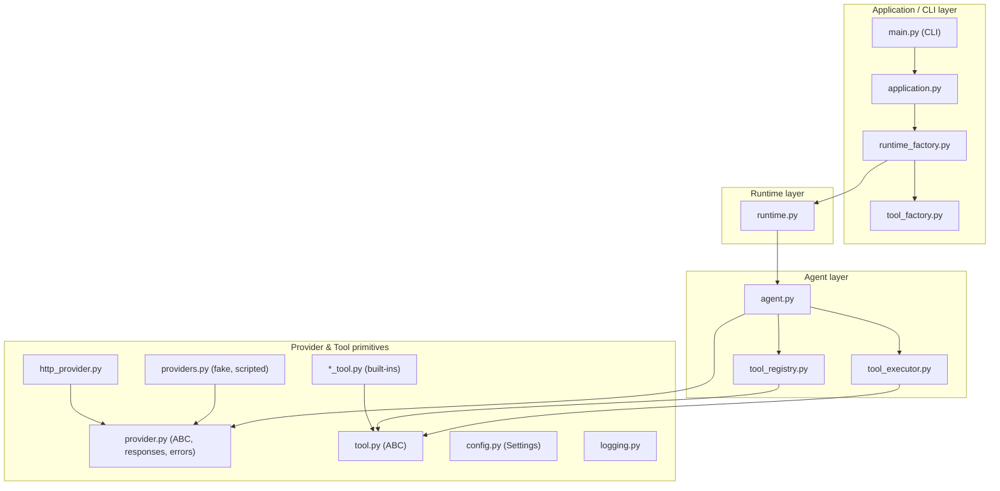

# Architecture

NexusAgent is a small, layered runtime. Each layer may only depend on the
layers below it — and this rule is **enforced by tests**
(`tests/test_architecture.py` parses the source with `ast` and fails on any
upward import), not by convention.

## Module map

| Module | Responsibility |
| --- | --- |
| `provider.py` | `Provider` ABC (`generate`, `generate_response`), response types (`TextResponse`, `ToolCallRequest`), `ToolSpec`/`ToolResult`, error hierarchy |
| `providers.py` | `FakeProvider` (deterministic, offline) and `ScriptedProvider` (replays a fixed response script) |
| `http_provider.py` | Vendor-neutral HTTP backend speaking the wire format in [`protocol.md`](protocol.md) |
| `tool.py` | `Tool` ABC: `name`, `description`, `execute(input) -> str` |
| `tool_registry.py` | Name → tool mapping; duplicate registration is an error |
| `tool_executor.py` | Runs a tool, wraps failures in `ToolExecutionError` (original class preserved in the message) |
| `agent.py` | Validates input, runs the provider, executes the **bounded tool loop** |
| `runtime.py` | Facade over `Agent` (`run`, `execute_tool`, `list_tools`) + `create_runtime` |
| `config.py` | `Settings` from `NEXUS_*` env vars; local validation, no network |
| `factory.py` | `create_provider(name, config)` |
| `tool_factory.py` / `runtime_factory.py` / `application.py` | Composition: built-in tools → `Runtime` → `create_application_runtime()` |
| `main.py` / `__main__.py` | CLI (`nexusagent ...`, `python -m nexusagent ...`) |
| `logging.py` | `nexusagent`-namespaced logging helpers |

## The tool loop

`Agent.run()` implements the loop (see
[ADR 0002](adr/0002-tool-call-wire-format-and-agent-loop.md)):

1. Advertise available tools to the Provider as `ToolSpec`s.
2. Ask the Provider via `generate_response(prompt, tools, tool_results)`.
3. `TextResponse` → done; return `AgentResult(output, success=True)`.
4. `ToolCallRequest` → execute through registry+executor.
   Failures become error `ToolResult`s (never crash the run).
5. Feed `ToolResult`s back and repeat, bounded by `max_iterations`
   (default 10). Exceeding it returns a failed `AgentResult`.

## Design rules

- **Zero runtime dependencies.** Everything above is the standard library
  (`urllib`, `json`, `logging`, `argparse`, `dataclasses`). See
  [ADR 0003](adr/0003-packaging-and-publishing.md) for the packaging policy.
- **Sync only** ([ADR 0001](adr/0001-sync-first-core.md)); no hidden I/O —
  construction and validation never touch the network (also enforced by
  tests that fail if a socket is opened).
- **Immutable data.** Results, configs, specs are frozen dataclasses.
  `Settings`/`ProviderConfig` reprs mask `api_key`.
- **Explicit errors.** Typed exception hierarchy (`ProviderError` →
  `Configuration`/`Request`/`Response`; `ToolExecutionError`); the CLI turns
  them into clean one-line messages.
- **Public API is narrow.** Only what `nexusagent/__init__.py` exports is
  public; submodules may change without notice (the registry/executor
  classes are the documented extension points for custom tools).
